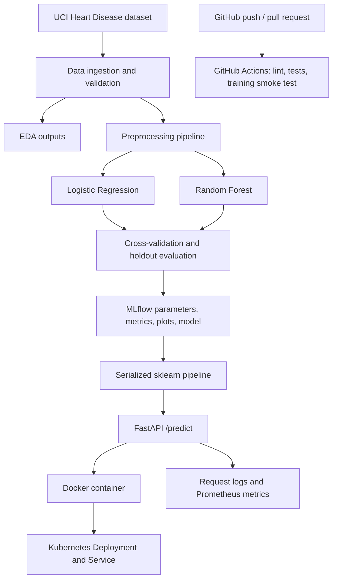

# Heart Disease MLOps — Assignment 1 (AIMLCZG523)

A reproducible reference implementation for the BITS Pilani MLOps Assignment 1. It includes data ingestion, EDA, model comparison, MLflow tracking, tests, GitHub Actions, FastAPI, Docker, Kubernetes manifests, and basic monitoring.

**Academic-use note:** run the pipeline yourself, inspect the implementation, personalize the analysis, and use only results/screenshots generated by your own execution. This is an educational demonstration, not a clinically validated diagnostic tool.

## Architecture



## Prerequisites
- Python 3.11 recommended
- Git
- Docker Desktop for container steps
- Optional: Minikube or Docker Desktop Kubernetes
- Internet access for the first dataset download and package installation

## Windows PowerShell setup

From the repository root:

```powershell
py -3.11 -m venv .venv
.\.venv\Scripts\Activate.ps1
python -m pip install --upgrade pip
pip install -r requirements.txt
```

If PowerShell blocks activation, use Command Prompt and run `.venv\Scripts\activate.bat`.

## Run the project

### Download and validate data
```powershell
python -m src.data
```

The script downloads a processed Cleveland heart-disease CSV from a public repository, stores it under `data/raw/`, normalizes the schema, and writes the processed CSV plus source metadata under `data/processed/`. The commonly used Cleveland target values are 0–4: `0` is mapped to class `0`, and values 1–4 to class `1`. Inspect the recorded source URL, schema, missing values, and target counts before reporting results. Public mirrors can change; verify provenance and columns.

### EDA
```powershell
python -m src.eda
```
Outputs: `reports/figures/` and `reports/eda_summary.json`.

### Train and track models
```powershell
python -m src.train
```
This compares Logistic Regression and Random Forest using stratified cross-validation and holdout metrics, logs runs to MLflow, and saves `artifacts/model.joblib`. Model selection is based on mean cross-validation ROC-AUC. Actual metrics must come from your run.

MLflow UI:
```powershell
mlflow ui --backend-store-uri ./mlruns --host 127.0.0.1 --port 5000
```
Open `http://127.0.0.1:5000`.

### Test and lint
```powershell
ruff check .
pytest -q
```

### Run API
Training must have generated `artifacts/model.joblib`.
```powershell
uvicorn api.main:app --host 127.0.0.1 --port 8000
```
Open `http://127.0.0.1:8000/docs`.

Synthetic example input (not a real patient):
```json
{
  "age": 58, "sex": 1, "cp": 0, "trestbps": 140, "chol": 240,
  "fbs": 0, "restecg": 1, "thalach": 150, "exang": 0,
  "oldpeak": 1.0, "slope": 1, "ca": 0, "thal": 2
}
```

PowerShell request:
```powershell
$body = @{
  age=58; sex=1; cp=0; trestbps=140; chol=240; fbs=0; restecg=1
  thalach=150; exang=0; oldpeak=1.0; slope=1; ca=0; thal=2
} | ConvertTo-Json
Invoke-RestMethod -Method Post -Uri http://127.0.0.1:8000/predict -ContentType "application/json" -Body $body
```

### Docker
Train the model first:
```powershell
docker build -t heart-disease-mlops:local .
docker run --rm -p 8000:8000 heart-disease-mlops:local
```

### Kubernetes (optional local deployment)
For Docker Desktop Kubernetes, enable Kubernetes in Docker Desktop settings. For Minikube:
```powershell
minikube start
docker build -t heart-disease-mlops:local .
minikube image load heart-disease-mlops:local
kubectl apply -f deployment/k8s/
kubectl get pods
kubectl get svc
kubectl port-forward svc/heart-disease-api 8000:8000
```
Call `http://127.0.0.1:8000/health` and `/predict`. The image must be available to the cluster.

## GitHub upload
Create an empty repository, then:
```powershell
git init
git add .
git commit -m "Initial MLOps assignment implementation"
git branch -M main
git remote add origin https://github.com/YOUR-USERNAME/heart-disease-mlops.git
git push -u origin main
```
Replace the URL with your own repository URL.

## Reproduce in BITS lab
Clone the repository there, create a fresh Python 3.11 environment, install from `requirements.txt`, and rerun the commands. Do not copy `.venv/`, `mlruns/`, or OS-specific environment files. Regenerate data and model artifacts from scripts. If the lab blocks internet access, transfer the dataset separately and document the source.

## Submission checklist
- Source repository, scripts, requirements, tests and CI workflow
- EDA charts and summary generated by your run
- MLflow experiment runs and model artifacts
- Local API and Docker build/run proof
- Kubernetes manifests and deployment evidence, or documented supported deployment
- Monitoring/logging evidence
- 10-page report updated with your real results
- Short video showing data-to-deployment flow
- Repository URL and access instructions

See `reports/REPORT_TEMPLATE.md` and `docs/SCREENSHOT_AND_VIDEO_CHECKLIST.md`.
